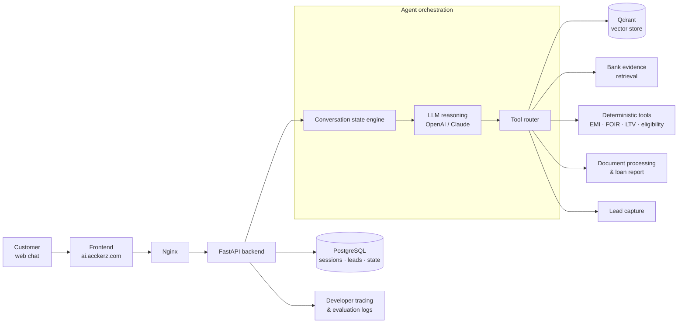

# Acckerz AI: Agentic Home-Loan & Real-Estate Advisor

**Live:** https://ai.acckerz.com · **Role:** AI Engineer: product design, architecture, LLM/RAG design, deployment · **Status:** In production (2026)

> This is a **showcase repository**. The production source code is private (client IP), so this repo has only the architecture, design decisions and feature write-ups. I'm happy to walk through the codebase in an interview.

---

## What it is

Acckerz AI does the first-level work of a home-loan agent (DSA → bank Processing Officer) for Indian home buyers:

- Talks to the customer and builds a structured profile (income, obligations, property, loan need)
- Checks uploaded documents and produces a **loan-readiness report**
- Runs **deterministic** eligibility, EMI, FOIR and LTV calculations
- Answers bank-policy questions from **current, sourced bank evidence** instead of model memory
- Captures qualified leads for the Acckerz team

It is not a generic chatbot. The domain knowledge comes from a loan agent with years of experience, and it is captured as a structured knowledge base.

## Core design principle

```
Customer State  +  Acckerz Knowledge  +  Current Bank Evidence  +  Deterministic Financial Tools  +  LLM Reasoning
```

**The LLM never invents numbers or bank policies.** Calculations run in tested Python tools, policies come from retrieved evidence, and the LLM reasons over and explains what the tools return. This keeps the advice reliable in a domain where a wrong number costs the customer money.

## Architecture



Deployed with **Docker** on **DigitalOcean**, behind Nginx.

## Key engineering decisions

| Problem | Decision |
|---|---|
| LLMs hallucinate loan maths | All financial maths is in deterministic Python tools. The LLM only calls them and explains the results. |
| Bank policies change often | Retrieval from current bank evidence with sources, not model memory |
| Long, multi-turn conversations lose context | An explicit **customer state engine** (structured slots) is kept separate from chat history |
| Expert knowledge lives in one person's head | A pipeline that turns a non-technical expert's knowledge (notes, a scanned book, cases) into a RAG knowledge base |
| Hard to debug agent behaviour | Developer tracing of every turn (retrieved chunks, tool calls, state diff) |

## Tech stack

**AI / LLM:** LLM APIs (OpenAI, Claude), RAG, embeddings, Qdrant, agentic tool-calling, prompt engineering, LLM evaluation and tracing  
**Backend:** Python, FastAPI, PostgreSQL  
**Infra:** Docker, Nginx, DigitalOcean, CI/CD

## Features shipped

- [x] Conversational loan advisor with persistent customer state
- [x] RAG over the Acckerz knowledge base with Qdrant
- [x] Deterministic eligibility, EMI, FOIR and LTV tools
- [x] Document check and downloadable loan-readiness report
- [x] Lead capture
- [x] Developer tracing

## Roadmap

- Bank comparison across lenders
- Property / locality valuation and best-use report agent
- Investment analysis (cash flow, NPV, IRR) using the same server-side calculators as acckerz.com
- Voice-to-knowledge pipeline: the domain expert speaks a case, and it is transcribed, reviewed and added to the knowledge base automatically

## How it was built

I designed the product, the architecture, the prompts and agent flow, and the evaluation approach. I implemented it using AI coding agents (Claude Code, Codex) under my direction, and reviewed, tested and deployed every change. This is how I work: fast, AI-assisted delivery with me owning the design and the quality bar.

## About me

**Shubhada Dandawate**, AI Engineer (LLM apps · RAG · agents) and Data Engineer at UST (dbt, Databricks, Azure/AWS). PG Diploma in AI & ML (IIT Bombay, in progress).

[LinkedIn](https://www.linkedin.com/in/shubhada-dandawate) · dandawate.shubhada@gmail.com · Open to remote AI Engineer roles
